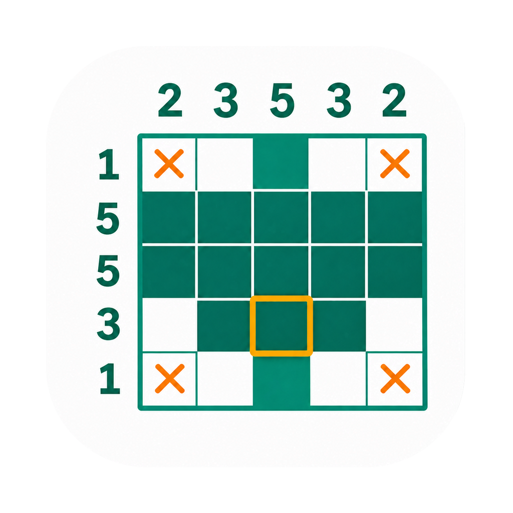
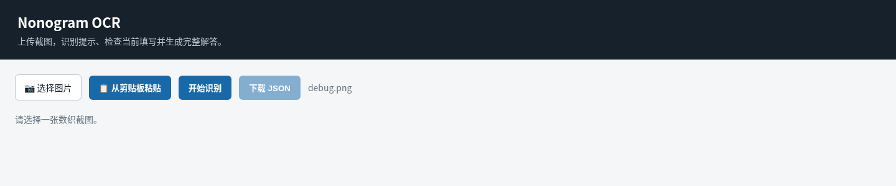
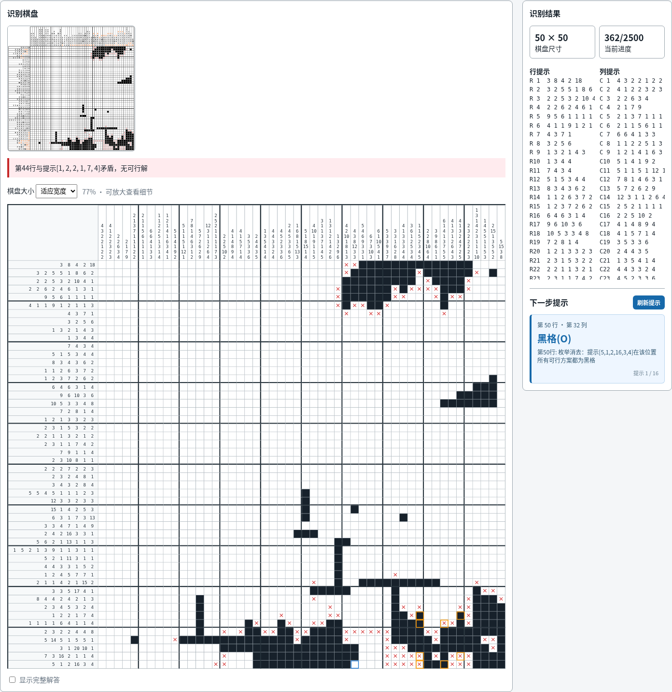
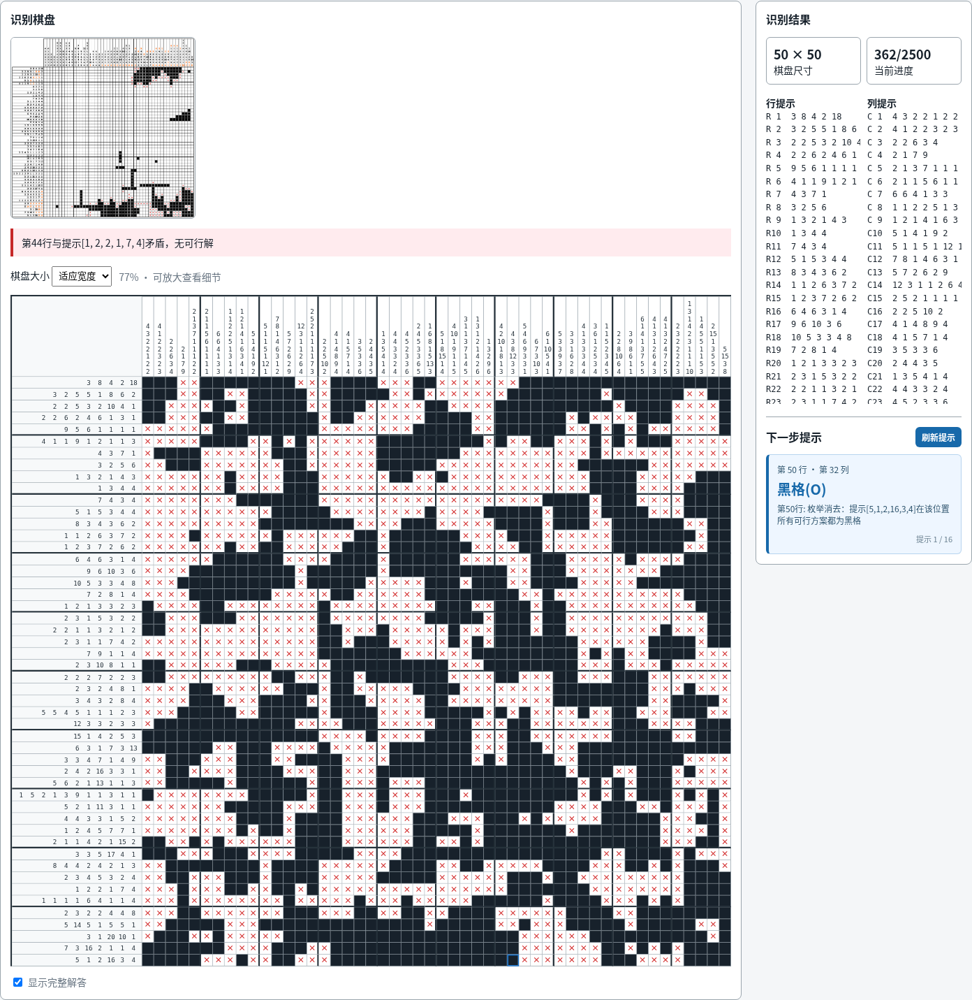

# nonogram助手



本地运行的数织（Nonogram）截图识别与求解工具：识别行列数字和当前棋盘、生成完整解答、检查填写冲突，并给出下一步提示。图片由本机处理，不需要上传到在线 OCR 服务。

支持 Windows / macOS 桌面窗口，也可以直接运行 Python Web 版或命令行版。

## 下载与安装

打开 [GitHub Releases](https://github.com/ChenRui0923/nonogram/releases)，选择一个**已发布且带下载附件**的版本，在 Assets 中下载对应文件。构建进度见 [Actions](https://github.com/ChenRui0923/nonogram/actions)；标签存在或 Actions 启动不代表安装包已经生成。所有平台构建通过后才发布 Release。

| 系统 | 下载文件 | 使用方式 |
| --- | --- | --- |
| Windows 10/11 x64 | `Nonogram-windows-x64.exe` | 双击运行 |
| macOS Apple Silicon（M 系列） | `Nonogram-macos-arm64.dmg` | 打开 DMG，将 App 拖入 Applications |
| macOS Intel | `Nonogram-macos-x64.dmg` | 打开 DMG，将 App 拖入 Applications |

- 桌面包无需安装 Python、字体或 Tesseract。
- Windows 界面使用 Microsoft Edge WebView2；如提示缺少运行库，安装 [WebView2 Runtime](https://developer.microsoft.com/microsoft-edge/webview2/)。
- macOS 使用系统 WebKit。当前版本尚无开发者证书签名和 Apple 公证；确认下载来源后，可在系统“隐私与安全性”中按提示允许打开。
- Release 中的 `SHA256SUMS.txt` 可用于核对下载完整性，`dependencies-*.txt` 记录各平台实际打包依赖。

## 使用教程

以下图片来自本项目 Web 界面的真实操作，示例为仓库中的 [`debug.png`](debug.png)（50×50）。桌面版使用同一界面；截图不是 Windows/macOS 原生窗口的实机验收图。

### 1. 选择一张完整截图

打开应用，点击 **选择图片**。桌面版也可以复制截图后点击 **从剪贴板粘贴**。选中后点击 **开始识别**。

截图应包含完整棋盘、顶部列提示、左侧行提示；尽量保持网格水平、文字清晰，避免裁掉边缘、旋转或透视变形。



浏览器版的剪贴板功能依赖浏览器权限；粘贴失败时直接选择图片即可。

### 2. 查看识别棋盘与冲突

识别完成后，左侧显示当前棋盘，右侧显示尺寸、已标记格数和下一步提示。

- 深色格：已填黑格；红色 `×`：已标记空格；白格：未知。
- 橙框：识别出的已有填写与求得解答不一致；先核对原图与提示数字，再修改游戏中的填写。
- 蓝框：右侧当前提示对应的位置。点击 **刷新提示** 切换已有提示。
- 红色警告表示当前填写与行列约束矛盾，并不一定代表题目本身无解。
- 题目可解且未发现填写冲突时，显示绿色“恭喜你，当前没有错误”提示，以及已完成百分比（黑格和已标记空格均计入进度）。
- 右侧行提示、列提示列表用于人工核对，内容可在各栏内滚动；它们与棋盘边缘的线索重复。



示例图识别为 50×50，已有标记为 362/2500；完整解答与这些标记有 8 处冲突。没有标准答案时，不能仅凭“求出了一个解”就认定所有 OCR 数字都正确。

### 3. 缩放与显示完整解答

棋盘默认 **适应宽度**，无需横向拖动即可看到全部列。线索数字使用加粗字体；小窗口下数字会相应缩小；需要看清细节时，切换到 **100% / 150% / 200%**，再在棋盘区域滚动。

勾选棋盘下方的 **显示完整解答** 查看结果，取消勾选返回识别出的当前棋盘。页面较长时向下滚动即可找到开关。



### 4. 导出与修正识别结果

点击顶部 **下载 JSON**，保存当前识别出的行列提示和棋盘。此按钮导出的是 OCR 数据，不是完整解答，也不会自动回填到游戏。

如果某个数字识别错了，可编辑导出的 JSON，再用命令行求解：

```bash
python main.py /path/to/puzzle.json
```

当前网页没有 JSON 导入或直接修改提示数字的功能。

## 识别范围与常见问题

**能保证各种比例的图都成功吗？**不能。求解器支持长方形棋盘，界面会随行列数和窗口宽度调整；OCR 则依赖截图字体、网格、清晰度和裁剪完整性。已验证仓库中的 30×25 和 50×50 示例；仓库中 1080×2400 的 JPG 未能检测到网格，不能保证任意长截图都可识别。

**提示“题目无解”怎么办？**先核对顶部和左侧的提示数字，尤其是粘连的两位数；必要时重新裁剪清晰截图，或导出 JSON 人工修正。行列黑格总数相同只是初步检查，不证明识别完全正确。

**有解但出现冲突格怎么办？**可能是当前填写有误，也可能是 OCR 识别有误；对照截图核对。命令行在仅凭行列推理确定唯一解时，会把差异标为确定错误；存在多解时不能把所有差异都归为玩家错误。

**为什么有时慢？**程序会依次识别、求解并生成提示。示例 `debug.png` 在开发云环境中首次 OCR 加求解约 2.5 秒，其中求解和提示约 0.6 秒；不是所有机器或题目的耗时保证。需要大量回溯的题目仍可能更慢，Windows 单文件程序首次解包启动也需要额外时间。

**端口被占用？**关闭之前启动的程序，或从终端指定新端口：Windows 为 `nonogram助手.exe --port 9000`；源码 Web 版为 `python web_app.py --port 9000`。

## 连续做题与缓存

**推荐的连续做题流程**：先正常识别第一张截图；后续仍在做同一道题时，勾选顶部“继续上一题（换题请取消）”，上传新截图。程序直接沿用上一题的线索，只读取最新棋盘；支持两次截图缩放比例不同。棋盘行列数改变时会自动回退到正常识别。

该选项是你对“仍是同题”的明确确认；相同行列数也可能是另一道题，程序不能仅凭尺寸区分，所以**换题务必取消勾选**。若怀疑上一次线索识别有误，也应取消勾选重新识别。未勾选时，仅自动复用像素轮廓能确认一致的线索，不对缩放后的不同图案进行模糊猜测。

真实 `debug.png`（1530×1502）到 `debug2.png`（1784×1754）已验证：勾选后复用 100/100 条线索，最新截图服务端约 0.11～0.13 秒，结果与完整 OCR/求解一致。未勾选时这组缩放图会重新识别线索，约 2.3 秒。

应用有三层缓存，全部保存在本机：

1. **相同文件**：图片字节完全相同，直接返回结果，跳过 OCR、求解和提示生成；文件改名不影响命中。
2. **填了几格后的新截图**：重新检测网格、读取当前黑格和叉号；未变化的行列线索直接复用。如果只改变部分线索高亮或边缘像素，只重新识别变化的线索条。状态栏显示“已复用 X/Y 条线索，已更新当前填写”。
3. **相同题目的解答**：线索一致且已通过行列约束传播证明唯一解时，复用该解答；根据最新填写重新生成冲突和提示。多解题不会盲目复用旧解答，仍结合当前填写重新求解。

线索复用比较完整线索像素轮廓，不根据“看起来相似”猜题。文字颜色先归一化，以适应游戏的完成高亮；不能匹配的线索就重新 OCR。换题、裁剪或缩放后可能减少命中或触发完整识别，避免错误复用。

开发云环境实测 50×50 图片首次约 2.7 秒，随后每次新增一个填写的截图约 0.10～0.11 秒（复用 100/100 条线索和唯一解，冲突数随新填写实时更新）。仓库的 `image.png` → `image copy.png` 是另一组真实不同进度截图，第二张复用 40/55 条线索，约 0.2 秒。相同文件直接命中约 0.003 秒；这些都是服务端耗时，不含上传、解包启动和页面绘制，实际速度依机器、截图及题目而异。

缓存重启后仍可使用；不保存上传图片原文件，只存识别结果、线索和可复用解答。结果、线索区、解答分别最多保留 32 份，单条线索最多保留 512 份；每条记录不超过 2 MiB，最近最少使用的先淘汰。算法或结果格式变化时更新缓存版本，缓存不可写时继续正常识别，失败请求不写入缓存。

缓存目录：

- macOS：`~/Library/Caches/nonogram-helper/`
- Windows：`%LOCALAPPDATA%/nonogram-helper/`
- Linux：`$XDG_CACHE_HOME/nonogram-helper/`，未设置时为 `~/.cache/nonogram-helper/`

关闭应用后删除目录内的 `results.sqlite3`、`clues.sqlite3`、`clue-strips.sqlite3`、`solutions.sqlite3` 即可清空对应缓存。更多测量方法见 [性能验证记录](docs/performance.md)。

## 从源码运行

推荐 Python 3.12，使用独立虚拟环境：

```bash
python -m venv .venv
# macOS / Linux
source .venv/bin/activate
# Windows PowerShell 则执行：.\.venv\Scripts\Activate.ps1
python -m pip install opencv-python numpy pillow pytesseract
python web_app.py
```

浏览器打开 `http://127.0.0.1:8765`。Web 服务使用 Python 标准库，无需 Flask/FastAPI。Tesseract 是可选的外部 OCR 引擎，内置字体模板识别无需安装它。

### 命令行

```bash
# 截图识别并求解，显式指定输出路径
python main.py debug.png --save-json /tmp/nonogram-result.json
# Windows 可将输出路径改为 result.json

# 只识别，不求解
python main.py --ocr-only debug.png result.json

# 从 JSON 求解
python main.py result.json

# OCR 调试输出到当前目录的 debug_ocr/
python main.py debug.png --save-json result.json --debug
```

注意：未指定输出路径时，图片识别默认覆盖仓库中的 `puzzle.json`；`--debug` 会写入 `debug_ocr/`。需要保留原数据时，请显式指定输出路径，并备份调试文件。

JSON 示例：

```json
{
  "row_clues": [[2], [2], [2], [2]],
  "col_clues": [[2], [2], [2], [2]],
  "current": ["OO..", "....", "..X.", "...."]
}
```

`row_clues` 从上到下，`col_clues` 从左到右；`current` 可省略。格子使用 `O`（黑格）、`X`（空格）、`.`（未知）。

## 开发、打包与 Release

### 测试

```bash
python -B -m unittest discover -s tests -v
```

测试覆盖短线索的穷举对照、无解和零线索，以及 `debug.png` 的真实 OCR、50×50 求解和冲突位置回归。

有匹配的截图与标准 JSON 时，也可运行 `python ocr_selftest.py screenshot.png reference.json`；退出码 2 表示存在差异。不要将不同填写进度的图片和 JSON 当作匹配测试素材。

### 在目标系统本地打包

PyInstaller 不支持在 Linux 上直接生成 Windows/macOS 原生程序，请在对应系统运行：

```powershell
# Windows PowerShell
.\build_windows.ps1
# 输出 dist\nonogram助手.exe
```

```bash
# macOS
bash build_macos.sh
bash build_dmg.sh
# 输出 dist/nonogram助手.app 和 dist/Nonogram-macOS.dmg
```

依赖位于 `requirements-build.txt`。打包程序支持无窗口启动检查：

```bash
# Windows
.\dist\nonogram助手.exe --smoke-test --port 0
# macOS
./dist/nonogram助手.app/Contents/MacOS/nonogram助手 --smoke-test --port 0
```

打包版本的检查日志默认写到系统临时目录 `nonogram-smoke.log`，可通过 `NONOGRAM_STARTUP_LOG` 指定路径；检查不打开 WebView 窗口，验证 HTTP 页面、内置字体和基本求解。完整图形界面、剪贴板和系统安全提示仍需要目标系统实机验收。

### 自动构建与版本发布

[Desktop builds and releases](https://github.com/ChenRui0923/nonogram/actions) 工作流先测试，再分别在 Windows x64、macOS Intel 和 Apple Silicon 上打包。所有任务通过后才上传三个安装包、依赖清单与 SHA-256 校验值到 Release。

```bash
# 使用尚未发布过的新版本号；不要覆盖旧标签
git push origin HEAD:main
git tag v0.1.1
git push origin v0.1.1
```

也可以在 Actions → Desktop builds and releases → Run workflow 手动构建：这种方式只产生 Actions artifacts，不发布正式版本。仓库需要启用 Actions；发布任务需要 `GITHUB_TOKEN` 的 `contents: write` 权限。

Windows 启动检查超时时，请查看该步骤输出和 `windows-startup-diagnostics` 附件。日志包含阶段信息；Python 启动后卡住超过 90 秒时会保存线程堆栈。如果没有日志，说明程序尚未进入 Python runtime hook，需要排查单文件解包或系统拦截。Node.js 弃用警告和程序启动失败是两类问题，应以失败步骤的实际错误为准。

### 文件结构

| 路径 | 用途 |
| --- | --- |
| `desktop_launcher.py` | 桌面窗口、原生剪贴板、无窗口启动检查 |
| `web_app.py` / `web_index.html` | 本地 HTTP 接口与界面 |
| `main.py` | 命令行识别、求解和诊断 |
| `ocr_nonogram.py` / `assets/fonts/` | 网格检测、数字和棋盘识别、模板字体及许可 |
| `solver.py` / `hint.py` | 约束传播、回溯搜索、冲突检查和提示 |
| `tests/` | 回归测试 |
| `docs/screenshots/` | 实际使用截图 |
| `.github/workflows/release.yml` | 多平台构建与 Release |
