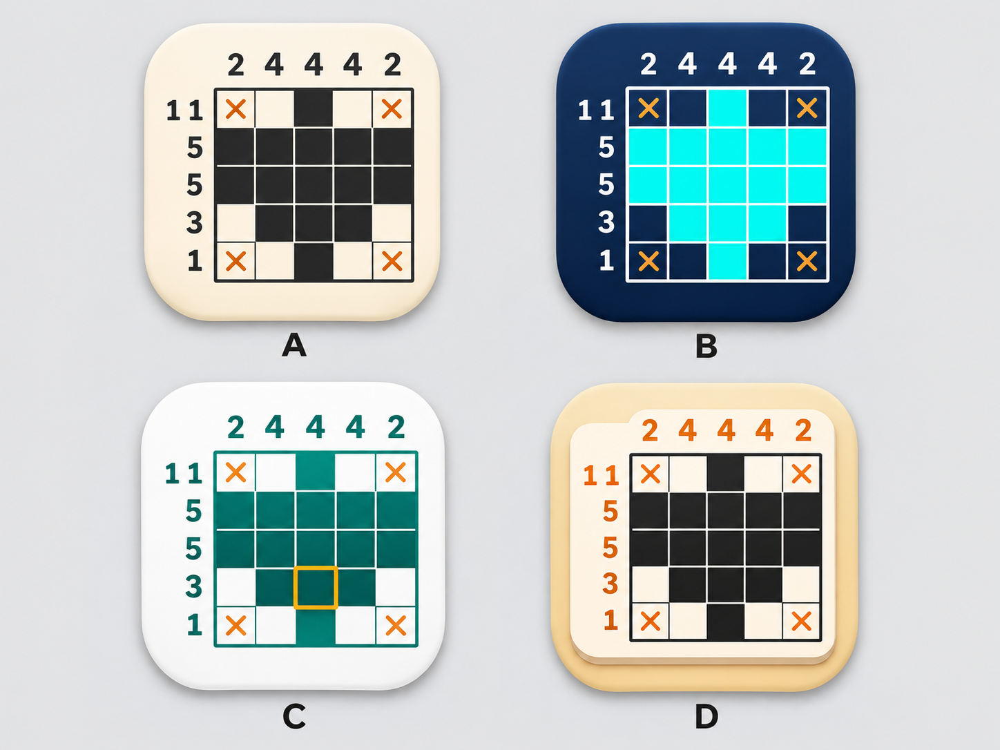
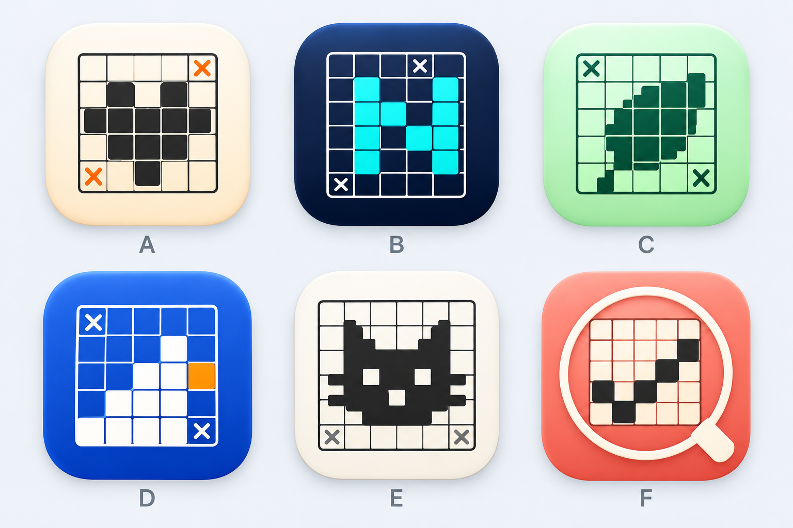

# 应用图标备选

这些图片是设计方向草图，尚未替换应用图标。定稿时需要重新校准网格、数字线索和像素图案，确保符合数织规则，再导出 Windows ICO 和 macOS ICNS。

## 数织主题（最新一组）

加入了顶部和左侧数字线索。上排为 A、B，下排为 C、D。

- **A**：奶油白底、黑色网格、橙色叉号。
- **B**：深蓝底、青色格子、白色数字。
- **C**：白底、青绿网格、橙色提示框。
- **D**：暖黄底、纸质卡片、橙色数字。

[打开原图](nonogram-options.png)

## 第一组探索

上排为 A、B、C，下排为 D、E、F。

[打开原图](initial-options.png)
